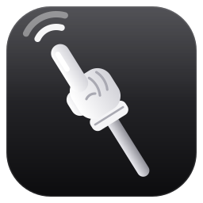
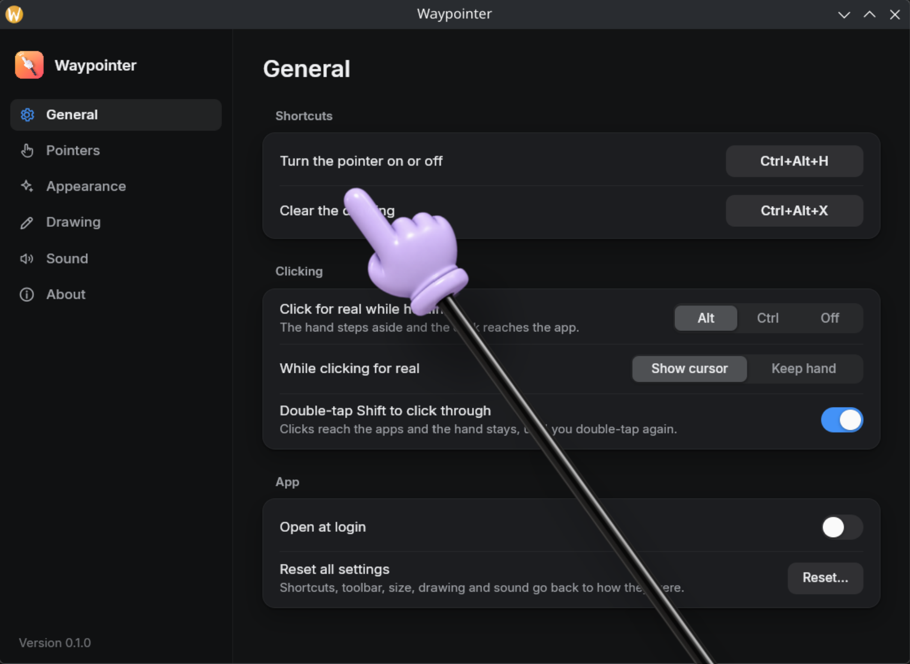
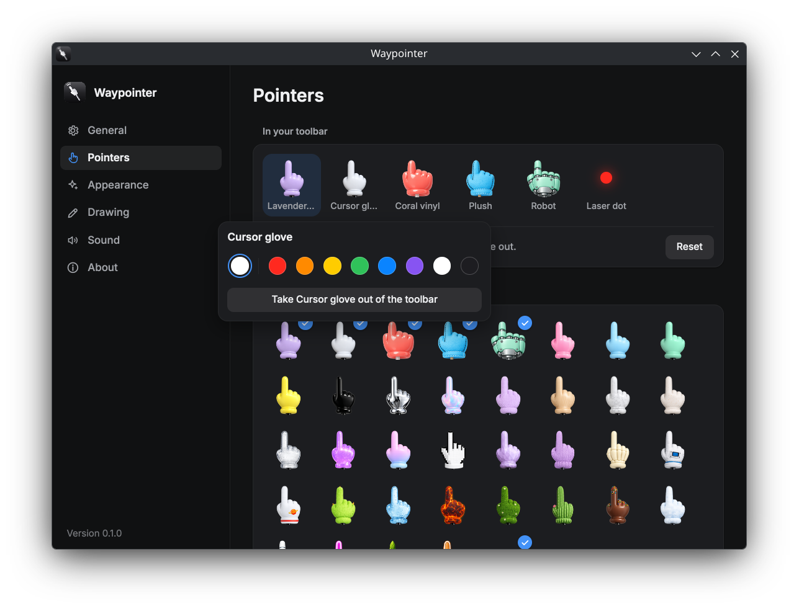

<p align="center">
  
</p>

<h1 align="center">Waypointer</h1>

<h3 align="center">A tiny hand on a stick that points at things on your screen.</h3>

<p align="center">
  The Linux version of <a href="https://github.com/nilbuild/tinyhand">TinyHand</a> for macOS.<br>
  Made for KDE Plasma on Wayland. Works on other Wayland desktops too, with fewer extras.
</p>

<h5 align="center">
  <a href="#install">Install</a> |
  <a href="#how-to-use">How to use</a> |
  <a href="#desktops">Desktops</a> |
  <a href="#automation">Automation</a> |
  <a href="https://github.com/Felitendo/waypointer/issues">Report a bug</a>
</h5>

<p align="center">
  
</p>

Turn it on and your cursor becomes a toy hand on a stick. Click to tap, drag to draw, and
nothing underneath gets clicked. Great for screen shares, recordings and presentations.

## Install

There is no package yet. Build it from source:

```bash
sudo pacman -S --needed rust libxkbcommon wayland
```

```bash
git clone https://github.com/Felitendo/waypointer.git
```

```bash
cd waypointer && make && sudo make install
```

Or, without root, for your user only: `make install PREFIX=~/.local`.

Then start **Waypointer** from the app menu. It lives in the system tray and opens at login
from then on (switch that off in the settings).

## How to use

| | |
|---|---|
| Click the tray icon, or **Ctrl+Alt+H** | Turn the pointer on or off |
| Right-click the tray icon | Menu and settings |
| Click | Tap (nothing underneath gets clicked) |
| Hold and drag | Draw on the screen |
| Hold **Ctrl** while drawing | End the line in an arrowhead |
| Hold **Alt** | Click for real: the hand steps aside |
| Double-tap **Shift** | Clicks go through to the apps and the hand stays, until you double-tap again |
| **Ctrl+Alt+X** | Clear the drawing |
| **Esc** | Clear everything and turn the pointer off |

While the pointer is on, a small toolbar at the bottom of the screen lets you pick one of 36
hands or a laser dot, or exit. The ink button does what a double tap on Shift does: your clicks
reach the windows and the hand stays, until you click it or double-tap again. Click the speaker
to mute the tap sound. Rest the pointer on either to pick the ink colour or set the volume. The
panels stay usable with the normal cursor.

You can make your own hand too: describe it, let ChatGPT or another image tool draw it, and
pick the PNG. Waypointer checks it and puts it on a stick.

<p align="center">
  
</p>

Every setting is in the settings window: shortcuts, which key clicks for real, the toolbar,
the pointer size, the ink, the tap sound and its volume. On the **Drawing** page you pick the
ink, how long drawings stay, and whether a ring spreads where you click.

## Desktops

| | KDE Plasma (Wayland) | Hyprland, Sway, other Wayland | GNOME |
|---|:---:|:---:|:---:|
| Hand, laser, drawing, toolbar | ✓ | ✓ | not yet |
| Global shortcuts and Esc | ✓ | bind `waypointer toggle` yourself | |
| Hold Alt, double-tap Shift | ✓ | | |
| Panels stay usable | ✓ | | |

The extras on KDE come from KWin: KGlobalAccel for the shortcuts, its keystate protocol for
Alt, Ctrl and Shift, and small KWin scripts that say where the panels and the cursor are.
GNOME has no layer-shell, which Waypointer needs to draw over other windows.

## Automation

The `waypointer` command drives the running app, and starts it when it isn't running:

```bash
waypointer toggle
```

| Command | Action |
|---|---|
| `on`, `off`, `toggle` | Turn the pointer on, off, or flip it |
| `clear` | Clear the drawing |
| `style <id>` | Switch to a hand (or `laser`) and turn the pointer on |
| `sound on`, `off`, `toggle` | Tap sound for the current pointer |
| `volume <0-100>` | Volume of the tap sound, in percent |
| `settings` | Open the settings |
| `quit` | Quit Waypointer |

Links work too: `xdg-open waypointer://style/robot`. So does D-Bus: the service
`de.felitendo.Waypointer` has `Toggle`, `On`, `Off`, `Clear`, `Run` and `State` on `/Waypointer`.

While Waypointer runs, it keeps its state in `$XDG_RUNTIME_DIR/waypointer/state.json`: whether
the pointer is on, the style, whether sound is on, and every style with its `id`, name and type
(`hand`, `custom` or `laser`).

## Building

Waypointer is written in Rust and drawn with [Rune](https://github.com/anomalyco/rune), the
toolkit behind [Hex](https://github.com/anomalyco/hex).

```bash
make test
```

```bash
make run
```

## Credits

The hands, the sounds and the whole idea come from [TinyHand](https://github.com/nilbuild/tinyhand)
by nilbuild. Waypointer brings it to Linux.

## License

MIT. See [LICENSE](LICENSE).
